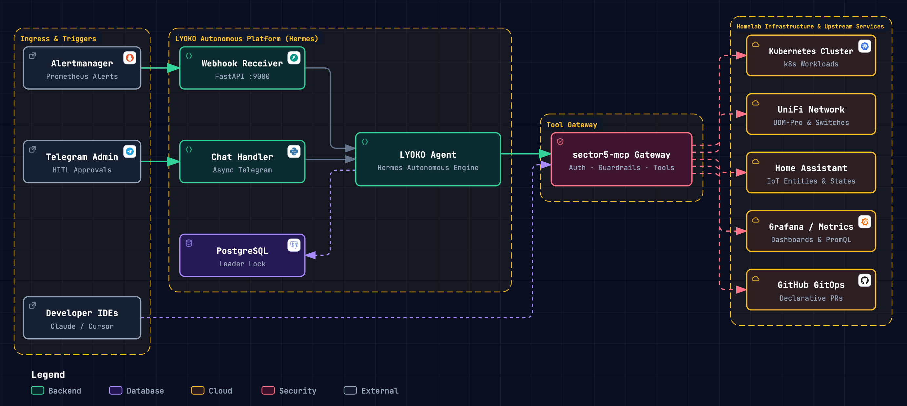
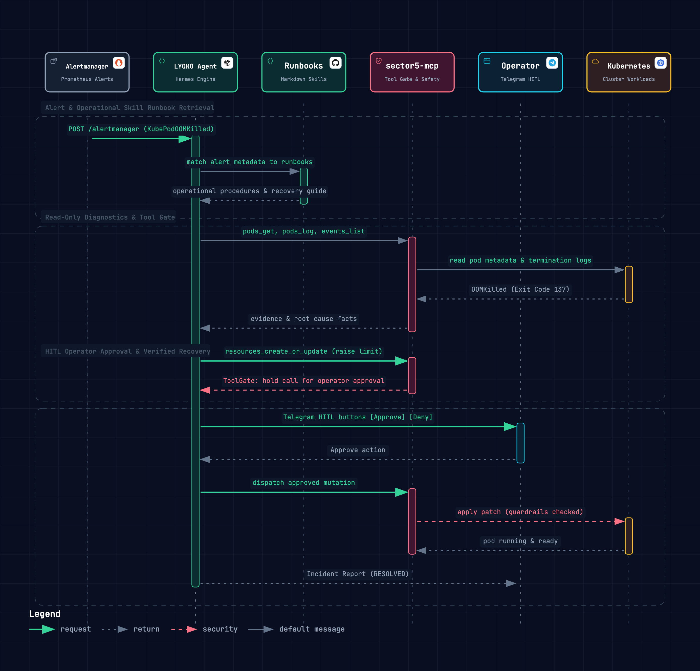

# System Architecture & Incident Lifecycle

This document describes the end-to-end architecture, autonomous orchestration, safety harness, and incident remediation lifecycle of `lyoko-ai-ops`.

---

## High-Level System Architecture

`lyoko-ai-ops` decouples intelligence from execution through two primary subsystems:

1. **`LYOKO` (Autonomous Remediation Engine)**: Built on **Hermes Agent** and **FastAPI**, handling alert webhooks from Prometheus Alertmanager and operator chat sessions via Telegram. LYOKO serves as a resilient, guardrail-protected cognitive wrapper over Hermes.
2. **`sector5-mcp` (Tool Gateway & Safety Harness)**: Built on **FastMCP**, aggregating upstream domain APIs (Kubernetes, UniFi, Home Assistant, Grafana, GitHub) behind strict guardrails and authentication.

  

---

## Autonomous Architecture & Safety Harness

LYOKO operates as an autonomous wrapper around Hermes Agent equipped with human-in-the-loop safety controls:

- **Hermes Autonomous Operator**: Investigates alerts end-to-end, correlates symptoms across infrastructure domains, formulates remediation plans, and verifies health restoration.
- **Dynamic Scoped Tools**: Direct access to upstream tools across Kubernetes, UniFi Network, Home Assistant, Grafana, and GitHub GitOps via `sector5-mcp`.
- **ToolGate Harness**: Ensures safety without relying on model judgment:
  - **Read-only tools** run freely during diagnosis and verification.
  - **Auto-approved tools** (`AUTO_APPROVED_TOOLS`) run unattended when explicitly pre-authorized.
  - **State-changing actions** require explicit human approval via interactive Telegram buttons.

---

## End-to-End Remediation Lifecycle

Every incident progresses through an autonomous event-driven pipeline:

1. **`route`**: Incoming Alertmanager webhooks always enter incident handling; Telegram messages are classified by an LLM into operator chat turns or incident alerts.
2. **`triage`**: Deterministic fast-path handlers evaluate incoming alerts (e.g., Argo CD autosync drift, crashloop backoffs) and resolve them immediately when matching runbooks apply.
3. **`resolve` (Hermes + ToolGate)**: Hermes conducts read-only root-cause diagnosis across logs, events, and metrics. If a fix is needed, Hermes formulates the smallest reversible patch and executes it through the `ToolGate`. After applying modifications, Hermes performs health verification.
4. **`notify`**: Builds a structured incident report (`RESOLVED` or `ESCALATED`) reflecting tools actually executed and verified recovery, posting the outcome to Telegram.

### Incident Remediation & Lifecycle Sequence

  

---

## Operational Skills & Continuous Learning

LYOKO integrates operational runbooks and persistent session context to improve resolution quality:

- **Hermes Native Memory**: Persistent memory and user preferences stored across sessions.
- **Operational Runbooks & Skills (`SkillMatcherService`)**: Dynamically matches alert metadata against curated operational procedures (Markdown runbooks in `application/skills/`).
- **Dynamic Context Interpolation**: Injects matched runbook skills and operational guidelines dynamically into the agent prompt before investigation begins.

---

## Related Documentation

- [Security & Guardrails](security-guardrails.md)
- [sector5-mcp Package Guide](../packages/mcps/sector5-mcp/README.md)
- [LYOKO Agent Package Guide](../packages/agents/lyoko/README.md)
