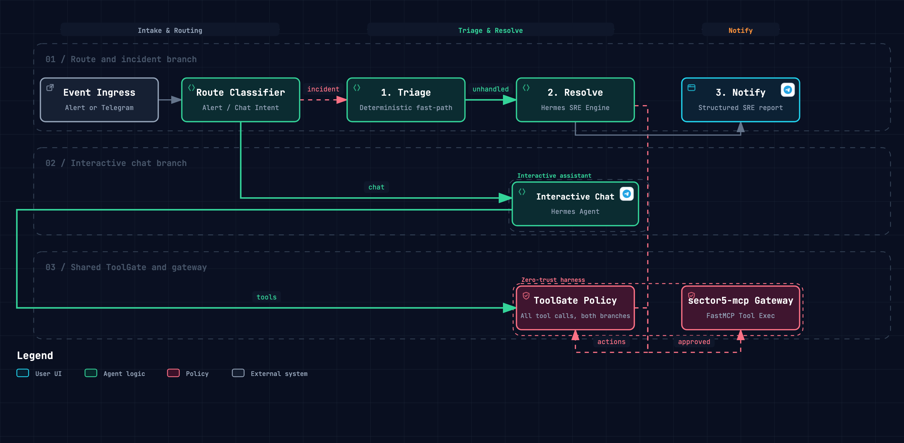

<div align="center">

# LYOKO

### Event-Driven Autonomous SRE Engine

[](https://github.com/NousResearch/Hermes-Function-Calling)
[](https://fastapi.tiangolo.com)
[](https://www.python.org/downloads/)
[](https://langfuse.com)
[](https://opensource.org/licenses/MIT)

<p>
  <b>L</b>ive <b>Y</b>aml <b>O</b>ptimization & <b>K</b>8s <b>O</b>rchestration — Hermes-powered autonomous self-healing engine and Telegram operator interface operating through <code>sector5-mcp</code>.
</p>


</div>

---

**LYOKO** acts through the `sector5-mcp` gateway across Kubernetes, UniFi, Home Assistant, Grafana, and GitHub in two core operating roles:
1. **Autonomous incident remediation**: receives an alert (Prometheus Alertmanager webhook), fast-paths deterministic triage, and has Hermes autonomously investigate root causes, propose fixes, ask the human for approval unless trusted, apply them, and verify recovery.
2. **Interactive chat assistant**: a Telegram interface through the same domain capabilities, to answer questions about the infrastructure and operate it, for example scale a workload, inspect a UniFi device, or change a Home Assistant entity.

Both roles are unified in a clean, event-driven workflow engine powered by **Hermes Agent**, sharing the same domain capabilities, ToolGate approval policy, and Langfuse traces.

## How it works
 
Every event enters the workflow at `route` and takes one of two branches:
- **Interactive Chat**: The **Hermes Agent** handles operator queries, plans multi-step actions, and operates infrastructure under ToolGate.
- **Incident Remediation**: Autonomous SRE workflow (`triage` ➔ `resolve` ➔ `notify`) driven by Hermes Agent and ToolGate.

<p align="center">
  
</p>

| Node / Component | What it does |
| :--- | :--- |
| `route` | Alerts always take the incident branch. For a Telegram message, an LLM classifier decides between `chat` (interactive queries/instructions) and the incident branch (reports of broken infrastructure). |
| `triage` | Fast-path deterministic evaluation for known alerts (e.g. Argo CD autosync) before invoking heavy LLM reasoning. |
| `Hermes Agent` | Operates across infrastructure domains under ToolGate, diagnoses root causes, executes remediation plans, and verifies health restoration. |
| `resolve` | End-to-end incident investigation, safe remediation under ToolGate approval, and verification by Hermes Agent. |
| `notify` | Builds a structured incident report (`RESOLVED` or `ESCALATED`) with approved/denied actions and recovery verification. |


### Tool gate

Safety does not depend on the model behaving. Every upstream tool call goes through a gate that applies the same policy to any tool, whatever system it belongs to and whichever branch made the call:

1. **Read-only tools** (`READ_ONLY_TOOLS`) always run. The default patterns cover inspection tools such as `k8s_pods_get`, `k8s_pods_log`, `k8s_events_list`, and `ha_get_*`.
2. **Auto-approved tools** (`AUTO_APPROVED_TOOLS`) run without asking and are recorded. The default is empty.
3. **Everything else needs approval.** LYOKO sends Telegram buttons that show the exact tool and arguments, and waits up to five minutes for the operator. A timeout counts as a denial.

If no approval channel is configured, changes are refused. They are never approved by default. The incident report is built from what the gate actually allowed, not from the model's own account of what it did. The gateway's own guardrails still apply to every call.

> [!NOTE]
> Tool names are matched with glob patterns, and a name that matches neither list is treated as state-changing. For example, `unifi_execute` is a generic executor, so each call asks for approval even when it only reads.

## Telegram chat assistant

LYOKO connects directly to Telegram as a bidirectional operations assistant:
- **RBAC Authorization**: Restricts access via `TELEGRAM_ALLOWED_USER_IDS` and `TELEGRAM_ALLOWED_CHAT_IDS`.
- **Hermes agent execution**: The chat handler processes operator requests under ToolGate protection.
- **Approvals in chat**: a change you ask for shows the same Approve / Deny buttons as an alert. Messages are handled concurrently, so a request waiting for your answer does not block other messages or the button click itself.
- **Clean HTML Formatting**: Automatically converts LLM Markdown into Telegram-compliant HTML tags without mangling underscore identifiers (`MOVISTAR_25EO_IOT`).

## Observability

Each event produces **one Langfuse trace**, and everything it does is a named span inside it:

```text
telegram-chat-interaction / lyoko-<alert>-<id>   one trace per event
├── route
│   └── route-llm                                routing decision (messages only)
└── chat | triage | resolve
    └── hermes-agent                             Hermes autonomous SRE run
        ├── gateway_get_domain_tools             domain tool discovery
        ├── gateway_get_tool_schema              parameter schema inspection
        └── mcp:k8s_pods_log                     guarded tool execution (via gateway_call_tool)
```

- **Sessions**: Threaded per Telegram chat session (`telegram-{chat_id}-{date}-{time}`, reset with `/new`) and per incident (`incident-{id}`). Replying to an alert message continues that incident's session.
- **Environments**: Explicitly segregated (`ENVIRONMENT=local` vs `ENVIRONMENT=homelab`).
- **Cost & Token Tracking**: Real-time token usage and cost accounting across all generations.

## Configuration

Configure LYOKO using environment variables (in `.env` or Kubernetes ConfigMap/Secret):

| Variable | Default | Description |
| :--- | :--- | :--- |
| `ENVIRONMENT` | `local` | Operational environment tag (`local`, `homelab`, `production`). |
| `LYOKO_HOST` | `0.0.0.0` | Webhook receiver bind host. |
| `LYOKO_PORT` | `9000` | Webhook receiver bind port. |
| `OPENAI_API_KEY` | `""` | OpenAI API key for LLM diagnosis and chat. |
| `OPENAI_CHEAP_MODEL` | `gpt-4.1-mini` | Cost-effective LLM used for chat, routing, and subagents. |
| `OPENAI_DIAGNOSE_MODEL` | `o3-mini` | Stronger reasoning LLM used for autonomous incident resolution. Empty falls back to `OPENAI_CHEAP_MODEL`. |
| `OPENAI_USE_RESPONSES_API` | `true` | Use the OpenAI Responses API (`/v1/responses`) instead of Chat Completions. |
| `MCP_SERVER_URL` | `http://localhost:8000/mcp` | URL of the `sector5-mcp` gateway endpoint. |
| `SERVICE_TOKEN` | `""` | Bearer token for authenticating against `sector5-mcp`. Required when the gateway runs with `AUTH_ENABLED=true`. |
| `MCP_FAIL_FAST` | `true` | Abort startup if the gateway rejects credentials (401/403) or the URL is not an MCP endpoint (404). |
| `READ_ONLY_TOOLS` | inspection patterns (`get_*`, `*_list`, `*_log`, ...) | Glob patterns of tools the incident agent may call freely. Comma-separated or JSON list. |
| `AUTO_APPROVED_TOOLS` | `[]` | Glob patterns of state-changing tools that run during remediation without approval (e.g. `k8s_resources_scale`). |
| `MAX_AGENT_STEPS` | `15` | Maximum tool-use iterations of each incident investigation or remediation. |
| `HERMES_VENV_PATH` | `.venv-hermes` | Path to the virtual environment containing `hermes-agent`. |
| `HERMES_HOME` | `.hermes` | Path to persistent `HERMES_HOME` directory for sessions, skills, and memory. |
| `HERMES_MEMORY_ENABLED` | `true` | Enable native Hermes memory persistence (`MEMORY.md` / `USER.md`) across runs. |
| `HERMES_SERVER_URL` | `""` | Optional HTTP endpoint for always-on Hermes daemon service. |
| `MAX_TURNS_DIAGNOSE` | `15` | Maximum LLM turns for incident resolution. |
| `MAX_TURNS_CHAT` | `15` | Maximum LLM turns for chat turns. |
| `MAX_BUDGET_USD_PER_EVENT` | `0.10` | Maximum spending ceiling in USD per incident or chat event. |
| `CYCLE_DETECTION_WINDOW` | `2` | Number of identical consecutive tool calls triggering cycle detection. |
| `MAX_TOOL_CALLS_PER_RUN` | `20` | Maximum tool calls one agent run may execute before it must summarize. Bounds fan-out across large resource lists. |
| `MAX_TOOL_OUTPUT_CHARS` | `8000` | Maximum characters of a single tool result kept in the agent context; longer results are truncated. |
| `TELEGRAM_ENABLED` | `false` | Enable Telegram assistant, channel posting, and HITL approvals. |
| `TELEGRAM_BOT_TOKEN` | `""` | Telegram Bot Token from `@BotFather`. |
| `TELEGRAM_ALLOWED_USER_IDS` | `[]` | List of authorized Telegram user IDs. |
| `TELEGRAM_ALLOWED_CHAT_IDS` | `[]` | List of authorized Telegram channel/group IDs. |
| `TELEGRAM_DEFAULT_CHAT_ID` | `""` | Default chat ID for broadcast notifications and alerts. |
| `LANGFUSE_ENABLED` | `true` | Enable Langfuse tracing and observability. |
| `LANGFUSE_PUBLIC_KEY` | `""` | Langfuse Project Public API Key. |
| `LANGFUSE_SECRET_KEY` | `""` | Langfuse Project Secret API Key. |
| `LANGFUSE_HOST` | `https://cloud.langfuse.com` | Langfuse instance host URL. |
| `CHAT_SESSION_IDLE_TIMEOUT_SECONDS` | `900` | Idle seconds before chat session resets to a new trace context. |
| `POSTGRES_HOST` | `postgresql-rw...` | PostgreSQL hostname for distributed multi-pod leader locking. |
| `POSTGRES_PORT` | `5432` | PostgreSQL database port. |
| `POSTGRES_DB` | `lyoko` | PostgreSQL database name. |
| `POSTGRES_USER` | `lyoko` | PostgreSQL database username. |
| `POSTGRES_PASSWORD` | `""` | PostgreSQL database password. |
| `POSTGRES_URI` | `""` | Optional full PostgreSQL connection URI override. |

## Alertmanager integration

Configure your Prometheus Alertmanager `config.yml` to route the alerts you want LYOKO to handle. Any alert works, because LYOKO receives all of its labels and annotations. The routes below are examples:

```yaml
receivers:
  - name: "lyoko-remediation"
    webhook_configs:
      - url: "http://lyoko.aiops.svc.cluster.local:9000/webhook/alertmanager"
        send_resolved: false

route:
  group_by: ["alertname"]
  group_wait: 10s
  group_interval: 30s
  repeat_interval: 1h
  routes:
    - match:
        alertname: KubePodCrashLooping
      receiver: "lyoko-remediation"
    - match:
        alertname: KubePodOOMKilled
      receiver: "lyoko-remediation"
    - match_re:
        alertname: "Unifi.*Offline"
      receiver: "lyoko-remediation"
```

## Running locally

```bash
# Start LYOKO agent (FastAPI server on port 9000)
uv run --package lyoko python -m lyoko.main
```

## Testing

```bash
# Run LYOKO workflow, webhook, and connector test suites
uv run pytest tests/agents/lyoko/
```
